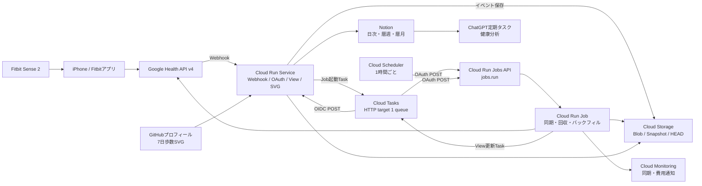

# Fitbit Personal Health Pipeline 設計書

| 項目 | 内容 |
|---|---|
| 文書バージョン | 3.0 |
| 更新日 | 2026-07-28 |
| 対象 | Fitbit Sense 2を使う単一所有者 |
| 実行基盤 | Google Cloud |
| 実装言語 | Python 3.13 |
| 主リージョン | `us-central1` |
| 永続データ基盤 | Google Cloud Storage |
| 日付基準 | Google Health APIのcivil time |
| BigQuery | 現時点では使用しない |

## 1. 結論

本システムは、Google Health APIからFitbitデータを取得し、Google Cloud Storage（GCS）へ保存し、日次値をNotionとGitHubへ反映する個人用健康データ基盤である。

現在はBigQueryを導入しない。GCS上のデータを次の層に分ける。

1. 内容ハッシュで識別する不変object
2. 年単位の完全な日次revision map
3. 全年の参照と同期位置を持つRoot Snapshot
4. GCS generation preconditionで更新するHEAD
5. HEADから再構築できる派生state

`state/data-head.json`のcompare-and-swap（CAS）更新だけを唯一のcommit pointとする。Blob、Manifest、Snapshot、lease、Notion、SVGの更新はcommit pointではない。

詳細rawデータは期限付きの非権威キャッシュとする。長期保存する正式な日次状態は、HEADが指すRoot SnapshotとYear Shardから到達できる`daily-canonical`である。

## 2. 目的

- Fitbit Sense 2の睡眠、心拍数、HRV、SpO2、歩数を取得する。
- 距離、Active Zone Minutes、安静時心拍、睡眠時呼吸数、運動時間も取得する。
- Webhook通知後、通常時は20分以内を目標にHEADへ反映する。
- API原本を変換処理より先にGCSへ保存する。
- 当日値、月曜始まりの暦週平均、暦月平均をNotionへ反映する。
- ChatGPTの定期タスクがNotionを読み、睡眠状態、疲労傾向、普段との差、注意変化、当日の活動・休養案を生成できるようにする。
- GitHubプロフィールには直近7日分の歩数だけを表示する。
- Fitbitの最終同期時刻を保存し、5日間同期されていない場合はメール通知する。
- 長期の日次履歴を小容量で無期限保存する。
- 将来BigQueryを追加しても、取得・正規化・日次計算を作り直さない。

## 3. 設計上の不変条件

1. HEAD CASだけがcommitを成立させる。
2. HEADが指さないobjectは現行データではない。
3. leaseの有無はcommitの正当性に影響しない。
4. API取得範囲と置換範囲はadapterごとに明示し、完全取得後だけ置換する。
5. Snapshotの完全状態と今回のcommit差分を混在させない。
6. 日次revisionはcommit generationやcommit時刻に依存しない。
7. NotionとSVGは古いgenerationへ逆行させない。
8. audit参照はpayloadの保持を延長しない。
9. 健康値、OAuth情報、Webhook秘密情報をログへ出さない。
10. GCS prefixの最大generation探索を正規の読取方法にしない。

## 4. 対象外

- 現時点でのBigQuery dataset、table、query、load job
- 複数ユーザー
- 一般公開向け管理画面
- 医療診断
- Fitbit端末からiPhoneまでの同期制御
- 詳細raw sampleの永久複製
- 複数のCloud Tasks queue
- 常駐Worker
- ページ単位のバックフィルcheckpoint
- 自動的な最古記録日の探索
- OpenAI APIをGoogle Cloud処理へ組み込むこと

## 5. 全体構成



### 5.1 Google Cloudリソース

| リソース | 数 | 用途 |
|---|---:|---|
| Cloud Run Service | 1 | Webhook、OAuth setup、View更新、歩数SVG |
| Cloud Run Job | 1 | 同期、回収、日次計算、バックフィル、Class A集計 |
| Cloud Tasks Queue | 1 | Job起動とView更新のHTTP task |
| Cloud Scheduler Job | 1 | Cloud Run Jobを毎時起動 |
| 健康データGCS Bucket | 1 | 原本、日次、Snapshot、state |
| Terraform state GCS Bucket | 1 | Terraform backend |
| Secret Manager | 1サービス | OAuth、Notion、署名・暗号鍵 |
| Artifact Registry | 1 | コンテナイメージ |
| Cloud Build | 1構成 | test、build、scan、deploy |
| Cloud Monitoring | 最小限 | 同期遅延、Job停止、Class A、費用 |

BigQuery、Firestore、Cloud SQLは使用しない。

### 5.2 リージョン

| リソース | ロケーション |
|---|---|
| Cloud Run Service / Job | `us-central1` |
| Cloud Tasks | `us-central1` |
| Cloud Scheduler | `us-central1`、timezoneは`Asia/Tokyo` |
| 健康データGCS | `us-central1` |
| Terraform state GCS | `us-central1` |
| Artifact Registry | `us-central1` |
| Secret Manager | ユーザー管理レプリケーション`us-central1` |

将来BigQueryを追加する場合もdatasetを`us-central1`へ置く。

## 6. 実行経路

### 6.1 Webhook受信

Cloud Run Serviceの公開endpoint：

```text
POST /webhooks/google-health
```

処理：

1. body sizeとContent-Typeを検証する。
2. `Authorization`をSecret Managerの値とconstant-time比較する。
3. `GOOGLE-HEALTH-API-SIGNATURE`をTinkでraw bodyに対して検証する。
4. JSON schemaを検証する。
5. `healthUserId`をHMAC化して所有者と照合する。
6. 変更区間を含むイベントをGCSへ不変保存する。
7. GCS保存完了後の時刻を10分bucketへ丸め、次のbucket境界を
   `schedule_time`とするJob起動Taskを作成する。
8. 保存とTask作成成功後に`204`を返す。

GCS保存またはTask作成失敗時は5xxを返し、Google Health APIの再送に委ねる。
Taskのbucketは受信開始時刻ではなくGCS保存完了後に取り直した時刻から決める。
これにより、保存処理が境界をまたいでも、すでにdispatchされた旧bucketのTask名を
再利用しない。

### 6.2 Cloud TasksからCloud Run Jobを起動

Cloud TasksはCloud Run Serviceを経由せず、Cloud Run Admin APIを直接呼ぶ。

```http
POST https://run.googleapis.com/v2/projects/<PROJECT_ID>/locations/us-central1/jobs/<JOB_NAME>:run
Authorization: Bearer <OAuth access token>
Content-Type: application/json

{}
```

Task設定：

- HTTP target
- method: `POST`
- auth: OAuth access token
- scope: `https://www.googleapis.com/auth/cloud-platform`
- service account: Cloud Tasks専用service account
- IAM: 対象Jobに`roles/run.invoker`
- body: `{}`
- Job overrideは使用しない
- task name: `<owner-hmac>-sync-<10-minute-bucket>`
- `schedule_time`: 対象10分bucketの終了境界

Webhook本文や変更区間をTask bodyへ入れない。GCSイベントとHEAD cursorが処理対象の正である。
同一bucketのWebhookは、境界までdispatchされない同名Taskへ合流する。したがって
Cloud Tasksの明示Task名による冪等性を保ちながら、通常は10分bucketあたりの
Job起動を1回に抑える。最初のWebhookで即時dispatchすると、後続Webhookが
削除済みTask名と重複して取り残されるため、即時実行はしない。

Jobs APIの成功はExecution作成成功を意味し、データcommit成功を意味しない。Job失敗時もイベントはGCSに残り、次回Taskまたは毎時Jobが回収する。
Jobは同期処理とlease解放後にHEADの`processed_objects`とGCSイベントを再照合する。
未処理イベントがあれば、完了時刻が属するbucketの次境界Taskを登録する。すでに
同bucketのTaskがあれば明示Task名の重複として合流する。これにより、長時間Job中に
別bucketの起動がleaseで空振りしても、毎時回収を待たずに再起動できる。
この終了時再照合とTask登録はcommit後のwake-up最適化であり、列挙、Snapshot読込、
Task登録のいずれかが失敗しても成功済みHEAD commitを失敗扱いにしない。失敗時は
種類だけを記録し、GCSイベントを残して毎時Schedulerへ委ねる。

### 6.3 Cloud Scheduler

Cloud Schedulerも同じJobs APIへ毎時`POST`する。

- auth: OAuth access token
- service account: Scheduler専用service account
- IAM: 対象Jobに`roles/run.invoker`
- timezone: `Asia/Tokyo`
- schedule: 毎時

毎時JobはWebhook欠落、Task作成失敗、Job失敗、Notion未反映を回収する。

### 6.4 View更新Task

HEAD commit成功後、Jobは同じCloud Tasks queueへView更新Taskを登録する。

```text
POST /internal/tasks/apply-views
```

- target: Cloud Run Service
- auth: OIDC ID token
- expected audience: Cloud Run Service URL
- task name: `<owner-hmac>-views-<head-generation>`
- body: `{"requested_generation": <generation>}`
- handlerはpayloadだけを信頼せず、必ず最新HEADを読む

Cloud Run Serviceは公開endpointも持つため、内部endpointでGoogle署名付きID token、audience、Task専用service accountをアプリ側でも検証する。

Queueの`max_concurrent_dispatches`は1とする。Job起動APIの応答は短いため、個人利用ではこの直列化を許容する。

## 7. Cloud Runの役割

### 7.1 Cloud Run Service

| Endpoint | 認証 | 処理 |
|---|---|---|
| `POST /webhooks/google-health` | Webhook secret + Tink署名 | Webhook保存、Job起動Task |
| `POST /internal/tasks/apply-views` | Google OIDC + service account照合 | Notion、SVG更新 |
| `GET /public/steps.svg` | 公開 | 現行7日歩数SVG |
| `GET /healthz` | 公開 | 秘密を含まない死活応答 |
| `GET /setup` | 公開 | setup code入力フォーム |
| `POST /setup/session` | CSRF + setup code | 一時OAuth session発行 |
| `GET /setup/oauth/start` | 一時session | OAuth開始 |
| `GET /setup/oauth/callback` | 一時session + OAuth state | token・所有者保存 |

### 7.2 Cloud Run Job

1回のJobは次を順番に行う。

1. advisory leaseを取得する。
2. HEAD、Root Snapshot、必要なYear Shardを読む。
3. Sense 2の最終同期時刻とGoogle Health settingsを取得する。
4. HEAD cursor以降のWebhookイベントを回収する。
5. data type cursorを含むcivil dateから現在日までを、最大直近90日に制限して日単位で再照合する。
6. API原本、normalized blob、ingestion Manifestを保存する。
7. 影響日、同じ暦週と暦月の途中平均を再計算する。
8. 影響年のYear Shardを作成する。
9. Root Snapshotを作成する。
10. HEADをCAS更新する。
11. 成功時だけView更新Taskを作成する。
12. 同期状態とClass A推定metricを出力する。
13. 現在処理がなく、Asia/Tokyoで当日未実行なら14日分のバックフィルを進める。

Notion障害はデータcommitを失敗させない。

現在照合の開始日はdata typeごとの成功済み`reconciled_through_date`を優先し、このfieldがない旧Snapshotだけ前回のFitbit最終同期時刻を現在のcivil time zoneへ変換して使用する。開始日を再取得することで少なくとも1 civil日のoverlapを持たせる。

- 初回は昨日と今日を取得する。
- Fitbit最終同期時刻が進んだ場合、全data typeをcursor日から今日まで再取得する。
- 1回の現在照合は各data typeとも直近90日までとし、API取得と置換は1 civil日単位で行う。
- 高頻度詳細はこの現在照合で直近90日を保証し、それより古い詳細は保証しない。
- 90日より古い未照合区間がある非高頻度data typeは、その区間末尾へbackfill cursorを戻し、通常の低優先度backfillで回収する。
- 正常な全範囲照合とHEAD CASが成功したdata typeだけ、`reconciled_through_date`を今日へ進める。Webhookの個別区間取得だけでは進めない。

## 8. GCS object構成

```text
gs://<health-bucket>/
  webhook-events/
  blobs/
    api-pages/
    normalized/
  manifests/
    ingestion/
    snapshots/
    snapshot-shards/
  daily-canonical/
  state/
    data-head.json
    owner.json
    raw-partitions/
    notion/
    views/
    oauth/
    alerts/
  leases/
  public/
    steps/
```

### 8.1 Object分類

| 種別 | 上書き | 役割 |
|---|---|---|
| API blob | しない | Google Health APIのレスポンス原本 |
| Normalized blob | しない | 期限付きraw cache |
| Ingestion Manifest | しない | 取得条件と検証結果 |
| Daily revision | しない | 正式な日次longデータ |
| Year Shard | しない | 1年分の現行daily revision map |
| Root Snapshot | しない | 全年参照、cursor、commit差分 |
| HEAD | CAS更新 | 現行Root Snapshotを指す唯一のcommit point |
| Materialized state | CAS更新 | Notion、SVG、raw cache index |
| Lease | CAS更新 | 重複処理を減らす最適化 |

## 9. Canonical contentと圧縮

### 9.1 Canonical JSON

`FHCJ-1`を定義する。

- UTF-8、BOMなし
- UnicodeはNFC
- object keyはUnicode code point順
- 不要な空白なし
- 整数は10進、先頭ゼロなし
- 小数はDecimal、指数表記なし、不要な末尾ゼロなし
- `NaN`、`Infinity`、負のゼロは禁止
- TimestampはRFC 3339
- UTCは`Z`
- 順序に意味がない配列はstable sort
- canonicalizer versionをManifestへ保存

### 9.2 Canonical NDJSON

- 各rowをFHCJ-1でserializeする
- rowは日次schemaの一意keyでsortする
- separatorはLF
- 最終rowの後にもLFを付ける
- hashは圧縮前NDJSON bytesに対して計算する

### 9.3 決定的gzip

`gzip-v1`を定義する。

- compression level 9
- `mtime=0`
- filename空
- commentなし
- OS header byteを255へ固定
- gzip前とgzip後のSHA-256を記録
- GCS CRC32Cを検証
- `Content-Type: application/gzip`
- `Content-Encoding`なし
- `Cache-Control: no-transform`

URIはcanonical content hashを基準にする。gzip方式の変更による衝突を避けるため、pathにcanonicalization versionとencoding versionを含める。

## 10. HEAD commit model

### 10.1 HEAD

```json
{
  "schema_version": 3,
  "generation": 1842,
  "root_snapshot": {
    "uri": "manifests/snapshots/canonicalization=fhcj-1/encoding=gzip-v1/sha256/ab/<canonical-sha256>.json.gz",
    "canonical_sha256": "<canonical-sha256>",
    "object_sha256": "<gzip-bytes-sha256>"
  },
  "parent_generation": 1841,
  "updated_at": "2026-07-28T00:00:00Z"
}
```

- generationは成功した論理commitごとに1増加する。
- HEADの上書きは必ずGCS generation precondition付きとする。
- 初回作成は`ifGenerationMatch=0`を使う。
- precondition failureは競合として扱う。

### 10.2 Commit手順

1. HEADとHEAD object generationを読む。
2. 親Root Snapshotと必要なYear Shardを読む。
3. API取得、原本保存、正規化、検証を完了する。
4. Daily revisionをcontent-addressed URIへ保存する。
5. 影響年のYear Shardを保存する。
6. 完全状態とcommit差分を持つRoot Snapshotを保存する。
7. HEADを最初に読んだobject generationでCAS更新する。
8. CAS成功時だけcommit成立とする。

### 10.3 CAS失敗

CAS失敗時：

- 同一Job内でHEADを読み直さない
- 同一Job内で再計画しない
- 作成済みobjectを削除しない
- Jobは正常終了する
- 次回Jobが最新HEADから再取得・再計算する

同じcontent-addressed objectを勝者が参照している可能性があるため、CAS敗者が即時削除してはならない。

## 11. Root Snapshot

```json
{
  "schema_version": 3,
  "generation": 1842,
  "parent_snapshot": {
    "uri": "...",
    "canonical_sha256": "...",
    "object_sha256": "..."
  },
  "state": {
    "daily_year_shards": {
      "2025": {
        "uri": "...",
        "canonical_sha256": "...",
        "object_sha256": "...",
        "date_count": 365
      },
      "2026": {
        "uri": "...",
        "canonical_sha256": "...",
        "object_sha256": "...",
        "date_count": 209
      }
    },
    "data_type_cursors": {
      "steps": {
        "reconciled_through_date": "2026-07-28",
        "reconciled_at": "2026-07-28T00:05:00Z"
      }
    },
    "webhook_cursor": {},
    "backfill_cursors": {},
    "fitbit_last_sync_time": "2026-07-28T00:00:00Z",
    "time_zone": "Asia/Tokyo"
  },
  "change_set": {
    "commit_kind": "WEBHOOK",
    "changed_metric_dates": ["2026-07-28"],
    "changed_years": [2026],
    "raw_replacements": [],
    "ingestion_manifests": [],
    "created_at": "2026-07-28T00:00:00Z"
  },
  "references": {
    "retention": [],
    "audit": []
  }
}
```

### 11.1 完全状態

`state`はHEAD時点で必要な完全状態を持つ。

- 全年のYear Shard参照
- data type cursor
- Webhook cursor
- backfill cursor
- Fitbit最終同期時刻
- civil time zone

### 11.2 Commit差分

`change_set`は親Snapshotから今回変わった内容だけを持つ。

- commit種別
- 変更日
- 変更年
- raw cache置換
- ingestion Manifest
- commit時刻

親`state`へ`change_set`を適用した結果が新しい`state`と一致することをcommit前に検証する。

## 12. Year Shard

### 12.1 Path

```text
manifests/snapshot-shards/
  year=2026/
  canonicalization=fhcj-1/
  encoding=gzip-v1/
  sha256/ab/<canonical-sha256>.json.gz
```

### 12.2 Schema

```json
{
  "schema_version": 1,
  "year": 2026,
  "daily_revisions": {
    "2026-07-28": {
      "uri": "daily-canonical/schema_version=1/metric_date=2026-07-28/canonicalization=fhcj-1/encoding=gzip-v1/sha256=<canonical-sha256>.ndjson.gz",
      "canonical_sha256": "...",
      "object_sha256": "...",
      "row_count": 42,
      "source_generation": 1842
    }
  }
}
```

- 1年の全日付について現行revisionを1件ずつ保持する。
- 更新された年のShardだけを再生成する。
- 同じ日次contentを再計算した場合は既存revisionを再利用する。
- revision hashが変わらなければ`source_generation`も変更しない。
- 年末をまたぐ暦週再計算では複数Year Shardを作り、1つのRoot Snapshotで同時commitする。

Root Snapshotと全Year Shardを合わせて日次の完全状態と定義する。

## 13. 原本とnormalized cache

### 13.1 保存順序

```text
Google Health API
  → API原本blob
  → 正規化
  → 検証
  → normalized blob
  → ingestion Manifest
  → daily revision
  → Year Shard
  → Root Snapshot
  → HEAD CAS
```

API原本保存前に日次値、Notion、SVGを更新しない。

### 13.2 Content-addressed path

```text
blobs/api-pages/canonicalization=fhcj-1/encoding=gzip-v1/sha256/ab/<hash>.json.gz
blobs/normalized/record_kind=SAMPLE/data_type=heart-rate/canonicalization=fhcj-1/encoding=gzip-v1/sha256/cd/<hash>.ndjson.gz
blobs/normalized/record_kind=INTERVAL/data_type=steps/canonicalization=fhcj-1/encoding=gzip-v1/sha256/de/<hash>.ndjson.gz
blobs/normalized/record_kind=SESSION/data_type=sleep/canonicalization=fhcj-1/encoding=gzip-v1/sha256/ef/<hash>.ndjson.gz
blobs/normalized/record_kind=DAILY/data_type=daily-resting-heart-rate/canonicalization=fhcj-1/encoding=gzip-v1/sha256/01/<hash>.ndjson.gz
```

- 同じcanonical contentは同じobjectを再利用する。
- insertは`ifGenerationMatch=0`を使う。
- objectが既に存在する場合はhashとmetadataを検証する。
- retryで同じ原本を増やさない。

### 13.3 Ingestion Manifest

正規化検証後だけ作成する。

```text
manifests/ingestion/date=YYYY-MM-DD/
  canonicalization=fhcj-1/
  encoding=gzip-v1/
  sha256/<hash>.json.gz
```

最低限含めるもの：

- data type
- query window
- replacement scope
- page数
- API blob参照
- normalized blob参照
- source件数
- normalized件数
- deduplicate件数
- schema version
- normalizer version
- expected HEAD generation
- validation result

### 13.4 非権威キャッシュ

Fitbit／Google Healthクラウドを詳細rawデータの上流sourceとする。

GCS上のAPI blobとnormalized `SAMPLE`、`INTERVAL`、`SESSION`、`DAILY`は期限付き非権威キャッシュである。

- cacheの期限切れはHEAD commitを無効にしない
- cache indexは`state/raw-partitions/`へ置く
- cache indexはHEADから回復可能な派生状態として扱う
- audit Manifestが残っていてもpayloadは保持期限後に削除できる
- 保持期限外の再構築はGoogle Health APIで再取得できる範囲に依存する

## 14. Google Health API取得

### 14.1 対象data type

| 分類 | Data type |
|---|---|
| 歩数 | `steps` |
| 距離 | `distance` |
| 活動強度 | `active-zone-minutes` |
| 心拍 | `heart-rate` |
| 安静時心拍 | `daily-resting-heart-rate` |
| HRV | `heart-rate-variability`、`daily-heart-rate-variability` |
| SpO2 | `oxygen-saturation`、`daily-oxygen-saturation` |
| 睡眠 | `sleep` |
| 呼吸 | `respiratory-rate-sleep-summary` |
| 運動 | `exercise` |

原則として`users/me/dataSourceFamilies/google-wearables`のreconciled streamを使用する。

### 14.2 Pagingとchunk

- `nextPageToken`がある限り同じ条件で取得する。
- data typeごとのAPI上限より短いchunkをadapterで定義する。
- 高頻度dataは短い物理時間区間へ分割する。
- 429と一時5xxは指数backoffする。
- 永続4xx、scope不足、所有者不一致は無限retryしない。
- 全page取得完了前はreplacementをcommitしない。

### 14.3 取得範囲と置換範囲

- `query_window`: APIへ要求する範囲
- `replacement_scope`: 現行cacheから除外して新取得結果へ置換する範囲

次を満たす場合だけreplacementを採用する。

- 全page取得済み
- API errorなし
- queryとreplacementの境界規則が一致
- normalized rowがscope外を含まない
- conflicting duplicateなし

汎用`record_id`は作らない。

| Strategy | 対象 | Membership |
|---|---|---|
| `PHYSICAL_WINDOW_REPLACE` | 心拍、HRV、SpO2、歩数詳細 | adapter定義の時刻が`[start,end)` |
| `CIVIL_DAY_REPLACE` | daily data、daily rollup | 対象civil date |
| `SESSION_DAY_REPLACE` | 睡眠、運動 | 睡眠はcivil end date、運動はcivil start date |

### 14.4 Webhook変更区間

- `UPSERT`も`DELETE`も対象区間をAPIから再取得する。
- `DELETE`後の取得結果が空なら対象scopeをcache indexから除外する。
- 複数区間は捨てず、closed-open`[start,end)`としてunionする。
- 隣接区間は結合できる。
- 無関係な区間まで最小開始・最大終了へ広げない。
- HRVとSpO2は詳細と日次summaryが同じ日次metricへ統合されるため、片方のWebhookでも同日の両data typeを再取得する。片側だけを処理するbackfillでは、日次summaryを詳細値で上書きしない。

### 14.5 Backfill

- 高頻度詳細: 直近90日だけ
- 日次rollup: `2009-01-01`まで14 civil日単位で後方処理
- 睡眠・運動session: `2009-01-01`まで14 civil日単位で後方処理
- 現在照合が90日で切り詰められた場合、非高頻度data typeの未照合部分をbackfill cursorへ戻す
- Asia/Tokyoのcivil dateごとに1回、1 data typeだけ処理する
- ページ単位checkpointは持たない
- chunk完了時だけRoot Snapshotのbackfill cursorを進める
- API途中失敗またはHEAD CAS失敗時はcursorを進めない
- 現在データを常に優先する
- 20分SLOの対象外とする
- Class A 4,000回は警告であり停止条件にはしない

## 15. civil timeと日次処理

### 15.1 日付の優先順位

1. Record自身のcivil date/timeとUTC offset
2. daily rollupのcivil interval
3. `users.getSettings`のIANA `timeZone`
4. `utcOffset`

Cloud RunのUTC日付を健康データの日付として使わない。

### 15.2 日次canonical化

日`D`は、対象time zoneにおける`D+1 04:05`以降の最初のJobでcanonical化する。

- DSTをIANA time zoneで解決する。
- 日ごとにtime zoneと物理開始・終了を保存する。
- 睡眠はcivil end dateへ帰属させる。
- 運動はcivil start dateへ帰属させる。

| Status | 条件 |
|---|---|
| `PROVISIONAL` | D+1 04:05より前 |
| `CANONICAL_SYNCED` | 04:05以降かつ`lastSyncTime`がDのcivil end以降 |
| `CANONICAL_STALE` | 04:05以降だが`lastSyncTime`がDのcivil endより前 |
| `MISSING` | 同期済みだが値がなく、true zeroでもない |

`CANONICAL_STALE`も既知データの正式なrevisionとして保存し、同期後に新revisionへ置換する。

### 15.3 暦週・暦月平均

日`D`に対して：

- 暦週平均: `D`が属する週の月曜日から`D`まで
- 暦月平均: `D`が属する月の1日から`D`まで
- 暦週平均には当日値を含め、週の途中はweek-to-dateとして扱う
- 週は月曜日に始まり、日曜日のrowをその週の確定平均とする
- 暦月平均には当日値を含め、当月中はmonth-to-dateとして扱う
- 終了月は月末日のrowをその月の確定平均とする
- 欠損を0にしない
- true zero対応data typeかつ同期済みの場合だけ0とする
- 暦週平均は1日以上の有効値があれば計算し、coverageで有効日数を示す
- 暦月平均は1日以上の有効値があれば計算し、coverageで有効日数を示す

過去日`D`が修正された場合：

- `D`から`min(Dが属する週の日曜日, 現在日)`までの暦週week-to-dateを再計算する。
- `D`から`min(Dの月末, 現在日)`までの暦月month-to-dateを再計算する。
- 日付集合をunionし、重複する日を1回だけ再計算する。

## 16. Daily canonical schema

### 16.1 Path

```text
daily-canonical/
  schema_version=1/
  metric_date=2026-07-28/
  canonicalization=fhcj-1/
  encoding=gzip-v1/
  sha256=<canonical-sha256>.ndjson.gz
```

`schema_version`と`metric_date`は将来のBigQuery Hive partitioningに使用できる。

### 16.2 Row

```json
{
  "metric_name": "steps",
  "statistic": "observed",
  "period_kind": "DAY",
  "dimension_key": null,
  "value_num": 8432.0,
  "value_text": null,
  "unit": "count",
  "aggregation": "daily_sum",
  "period_start": "2026-07-28",
  "period_end": "2026-07-28",
  "sample_count": 1,
  "expected_count": 1,
  "coverage_ratio": 1.0,
  "data_status": "CANONICAL_SYNCED",
  "quality_flags": [],
  "source_data_types": ["steps"],
  "fitbit_last_sync_time": "2026-07-28T00:00:00Z",
  "time_zone": "Asia/Tokyo",
  "physical_day_start": "2026-07-27T15:00:00Z",
  "physical_day_end": "2026-07-28T15:00:00Z",
  "logic_version": "daily-v1"
}
```

Daily rowには次を入れない。

- commit generation
- commit ID
- commit時刻由来の`created_at`
- Snapshot URI
- 任意構造の巨大JSON

一意key：

```text
metric_name
+ statistic
+ period_kind
+ dimension_key
```

`statistic`：

- `observed`
- `mean`
- `delta`
- `delta_percent`
- `min`
- `max`
- `coverage`

`period_kind`：

- `DAY`: 当日値
- `CALENDAR_WEEK`: 月曜日から対象日までの暦週平均。日曜日rowが確定値
- `CALENDAR_MONTH`: 月初から対象日までの暦月平均

### 16.3 Schema version

```text
schemas/
  daily_metrics/
    v1.schema.json
    v1.bigquery.json
```

- 後方互換field追加は同versionで許可する。
- 型、意味、一意keyの変更は`schema_version=2`とする。
- 古いpartitionを自動で書き換えない。
- `v1 → current` converterをコード内に用意する。

## 17. Leaseと並行実行

```text
leases/<owner-hmac>.json
```

- TTL: 15分
- heartbeat: v1では行わない
- create: `ifGenerationMatch=0`
- update/delete: 対象object generationを指定
- Cloud Run Job timeout: 50分
- app処理予算: 45分

leaseはAPI取得とGCS操作の重複を減らす最適化である。

- lease取得失敗時はJobを正常終了する。
- leaseなしでもHEADが変わっていなければCASは成功し得る。
- leaseを持っていてもHEADが変わればCASは失敗する。
- 15分を超えたJobは後続Jobと重複し得るが、古いJobは最初に読んだHEAD generationへのCASだけを試し、HEADが進んでいれば失敗終了する。
- 整合性は常にHEAD CASが保証する。

## 18. RetentionとGC

### 18.1 固定lifecycle

| Prefix | 保持 |
|---|---:|
| `webhook-events/` | 30日 |
| `blobs/api-pages/` | 30日 |
| `blobs/normalized/record_kind=SAMPLE/` | 90日 |
| `blobs/normalized/record_kind=INTERVAL/` | 90日 |
| `blobs/normalized/record_kind=SESSION/` | 365日 |
| `blobs/normalized/record_kind=DAILY/` | 365日 |
| `manifests/ingestion/` | 365日 |
| OAuth一時session | 失効後24時間 |
| 一時処理履歴 | 90日 |

### 18.2 v1の長期保持と将来GC

Snapshot、Year Shard、daily revisionには単純なprefix lifecycleを設定しない。

- 現行HEAD: 無期限
- 現行HEADが指すRoot Snapshot: 無期限
- 過去Root Snapshot: v1では無期限
- Year Shard: v1では無期限
- daily revision: v1では無期限
- 各日付の現行daily revision: 無期限
- 未commit orphan: v1では自動削除しない

高容量になり得るAPI原本とnormalized cacheは18.1の固定lifecycleで削除する。content-addressedなcanonical、Snapshot、Year Shardは同じ内容を重複保存せず、個人利用では小容量のため、v1は誤削除を避けて保持する。CAS失敗直後にもobjectを削除しない。

`gc.py`は将来の到達可能性GCに使う純粋な判定器であり、v1のJobは列挙・削除を実行しない。健康データbucketが1 GiBを超えたら警告し、実測に基づいてactive GCの導入を判断する。

将来active GCを導入する場合は、次の安全条件をすべて実装する。

1. 月次dry-runで削除候補と削減見込みを記録する。
2. 現行HEADと過去90日のRoot Snapshotをrootとしてmarkする。
3. RootからYear Shard、Year Shardからdaily revisionをmarkする。
4. `references.retention`をmarkし、`references.audit`はmarkしない。
5. 30日のgrace periodを超えたunmarked objectだけを候補にする。
6. 削除直前にHEAD generationを再確認する。
7. GCS object generationを指定して削除し、同名の新しいobjectを巻き込まない。

### 18.3 Retention参照とaudit参照

```json
{
  "references": {
    "retention": [
      {
        "uri": "...",
        "canonical_sha256": "...",
        "retain_until": null
      }
    ],
    "audit": [
      {
        "uri": "...",
        "canonical_sha256": "...",
        "payload_retain_until": "2026-10-26T00:00:00Z"
      }
    ]
  }
}
```

- retention参照はGCでpayloadをpinする。
- audit参照は取得条件、hash、件数の証跡だけを残す。
- audit参照先は保持期限後に存在しなくてもよい。
- 期限切れpayloadの欠落は破損ではなく`RETENTION_EXPIRED`と判定する。
- v1ではretention参照を固定lifecycle対象prefixへ向けない。将来active GCを有効化した場合だけpin用途に使う。

## 19. Notion

### 19.1 表示内容

非公開Notion databaseの専用data sourceへ日付ごとに1ページ作る。

- Date
- Data status
- Source HEAD generation
- Fitbit last sync time
- 睡眠
- 心拍
- HRV
- SpO2
- 歩数
- 距離
- Active Zone Minutes
- 呼吸数
- 運動時間
- 各指標の暦週平均（月曜〜対象日、日曜確定）
- 各指標の暦月平均
- coverageとquality flag

Notion本文にはChatGPTが読みやすい固定順の短い表を生成する。API原本や高頻度sampleは書かない。

初回はtitleプロパティを1つ持つ空のdata sourceを作成し、integrationへ共有する。`make notion-configure`はNotion API `2026-03-11`を使い、次のschemaを冪等に作成または修復する。

| Property | Notion type | 用途 |
|---|---|---|
| `Date` | Title | civil dateとページ回収key |
| `Source HEAD generation` | Number | generation逆行防止 |
| `Content SHA-256` | Rich text | 内容一致時の更新省略 |
| `Data status` | Select | 日次データ状態 |
| `Fitbit last sync time` | Date | 同期鮮度 |

`Data status`の選択肢は`PROVISIONAL`、`CANONICAL_SYNCED`、`CANONICAL_STALE`、`MISSING`、`MIXED`、`INSUFFICIENT_DATA`とする。

data sourceはtitleプロパティをちょうど1つ持つ必要がある。CLIはそのtitleを`Date`へrenameし、他の必須プロパティを追加する。健康指標はプロパティを大量作成せず、固定順のページ本文へ書く。

### 19.2 Generation逆行防止

```text
state/notion/sync.json
```

```json
{
  "desired_generation": 1843,
  "applied_generation": 1842,
  "status": "IDLE",
  "applying_generation": null,
  "updated_at": "..."
}
```

- Notion書込みはCloud Tasksの単一writerだけが行う。
- handlerは最新HEADを読み、最新generationを適用する。
- `target_generation <= applied_generation`はno-opとする。
- Notionページにも`Source HEAD generation`を保存する。
- Notion側generationがtargetより新しい場合は上書きしない。
- JobはHEAD成功後に`desired_generation`を単調増加させる。
- Notion障害時はGCS commitを再実行しない。
- page IDとcontent hashはページ管理中無期限保存する。

Cloud Tasks retryにより同じgenerationが再実行されても、同じ内容hashならNotion更新を省略する。

## 20. GitHub歩数SVG

GitHubへ公開するのは直近7日分の歩数だけとする。

```text
public/steps/
  canonicalization=fhcj-1/
  sha256/<content-sha256>.svg

state/views/steps-head.json
```

`steps-head.json`：

```json
{
  "generation": 1842,
  "svg_uri": "public/steps/...svg",
  "content_sha256": "...",
  "updated_at": "..."
}
```

- SVGはcontent-addressedで上書きしない。
- pointerはGCS CASで更新する。
- 古いgenerationからのpointer更新を拒否する。
- `GET /public/steps.svg`はpointerが指すSVGだけを返す。
- SVGへ他の健康値、owner ID、最終同期時刻を含めない。
- `Cache-Control: public, max-age=300`とする。

## 21. ChatGPT定期分析

ChatGPTの定期タスクはNotion connectorを通して最新ページを読む。

生成内容：

- 睡眠状態
- 疲労傾向
- 暦週・暦月平均との差
- 普段との差
- 注意すべき変化
- 当日の活動案
- 当日の休養案

必須ルール：

- 医療診断をしない。
- 欠損と0を区別する。
- `CANONICAL_STALE`と`INSUFFICIENT_DATA`を明示する。
- 必要時は医療機関への相談を促す。
- Notionの`Source HEAD generation`が古い場合は古いデータとして示す。

OpenAI API keyやモデル呼出しをGoogle Cloud側へ追加しない。

## 22. OAuthと所有者

### 22.1 OAuth方針

- OAuth client type: Web Server
- User type: External
- Publishing status: In production
- Authorization Code Flow
- PKCE
- `access_type=offline`
- scope変更時またはrefresh token再発行時に`prompt=consent`

Scope：

```text
openid
https://www.googleapis.com/auth/googlehealth.activity_and_fitness.readonly
https://www.googleapis.com/auth/googlehealth.health_metrics_and_measurements.readonly
https://www.googleapis.com/auth/googlehealth.sleep.readonly
https://www.googleapis.com/auth/googlehealth.settings.readonly
```

Google Health API scopeはRestrictedとして扱う。Google Cloud Consoleでverificationまたはsecurity reviewを要求された場合は、回避せず利用開始条件として対応する。Testing状態の短期refresh token運用はしない。

### 22.2 Setup code

`make setup-code`は256bit codeを生成し、hashだけをGCSへ保存する。

- 有効期限: 10分
- 1回限り
- 再発行可能
- 再発行後も既存ownerと同じaccountだけ許可
- codeをURLへ含めない
- codeをログへ出さない

### 22.3 一時session

```text
state/oauth/sessions/<session-id-hmac>.json
```

状態：

```text
ISSUED
  → AUTHORIZING
  → CALLBACK_CLAIMED
  → COMPLETED

各有効状態
  → FAILED
  → EXPIRED
```

Session record：

```json
{
  "schema_version": 1,
  "session_id_hmac": "...",
  "status": "ISSUED",
  "issued_at": "...",
  "expires_at": "...",
  "csrf_token_hash": "...",
  "oauth_state_hash": null,
  "oidc_nonce_hash": null,
  "pkce_challenge": null,
  "pkce_verifier_ciphertext": null,
  "callback_claimed_at": null,
  "completed_at": null
}
```

- 全状態遷移をGCS generation precondition付きで行う。
- `POST /setup/session`でcodeをCAS消費し、sessionを発行する。
- cookieは`HttpOnly`、`Secure`、`SameSite=Lax`とする。
- PKCE verifierは専用AEAD keyで暗号化する。
- callback開始時に`CALLBACK_CLAIMED`へCAS遷移して再送を拒否する。
- token交換とowner照合成功後だけ`COMPLETED`にする。
- `FAILED`、`EXPIRED` sessionは再利用しない。

### 22.4 所有者

初回認可時に取得する。

- OpenID Connect `sub`
- Google Health `healthUserId`

保存値：

```text
HMAC-SHA256(application_hmac_key, identifier)
```

平文identifierをstateやログへ保存しない。再認可は保存済みの両HMACと一致するaccountだけ許可する。

## 23. Secret Manager

1. Google OAuth client credentials
2. Google OAuth refresh token
3. Notion integration token
4. Application HMAC key
5. Webhook endpoint authorization secret
6. OAuth session AEAD key

active versionは各secret 5以内とする。古いversionはrotation確認後にdestroyする。

## 24. ログとセキュリティ

### 24.1 ログへ出してよいもの

- event name
- data type
- 日単位へ丸めた時間範囲
- 件数
- HEAD generation
- duration
- status code分類
- Class A推定操作数
- Notion applied generation

### 24.2 ログ禁止

- 健康値
- API原本
- normalized row
- OAuth token、code、state、nonce、PKCE
- Authorization header
- Webhook本文
- Webhook署名
- `sub`、`healthUserId`
- Notion本文
- setup code
- session ID、cookie
- callback query string

### 24.3 Cloud Run callback request log

Cloud Run Serviceはrequest logを自動生成するため、Terraformで`_Default` sinkへproject-level exclusionを設定する。

対象：

```text
resource.type="cloud_run_revision"
log_id("run.googleapis.com/requests")
httpRequest.requestUrl=~"/setup/oauth/callback([?].*)?$"
```

- request logの生成自体は止められない。
- `_Default` log bucketへ保存しない。
- `_Required` audit logは変更しない。
- callback handlerはqueryを含まないsanitized application eventだけを出力する。

## 25. Fitbit最終同期

Root Snapshotへ`fitbit_last_sync_time`を保存する。

毎時Jobは最終同期からの経過秒数をCloud Monitoring metricとして出力する。

- 5日未満: 通知なし
- 5日以上: メール通知
- 通知済み状態を`state/alerts/fitbit-sync.json`へ保存
- 同じ未同期期間では1回だけ通知
- 再同期後にalert状態を解除

本システムが制御できない範囲：

- Fitbit端末からiPhone
- iPhoneからFitbit／Googleクラウド
- Google Health APIがWebhookを送るまで

## 26. Class A操作と費用

健康データGCSはStandard storage、soft delete無効、object versioning無効、Autoclass無効とする。

Cloud Run Job内のGCS `put` / `list`試行を数え、Job終了時にUTC月単位のstateへCAS加算する。`get` / `delete`、WebhookやView handlerなどService側の操作はv1の推定対象外とし、bucket全体の容量警告とCloud Billing Budgetを併用する。月次state自身の書込試行とCAS競合時の再試行も推定値へ含めるが、推定stateの更新失敗によって、すでに成功した健康データのcommitを失敗扱いにはしない。

| 当月推定 | 動作 |
|---:|---|
| 3,000未満 | 通常 |
| 3,000以上 | 予告通知 |
| 4,000以上 | 強い警告 |

4,000回は収集停止条件ではない。

- Webhook保存
- 現在データ取得
- HEAD commit
- 日次canonical化
- Notion／SVG回収

は継続する。

backfillとrebuildは延期できる。Cloud Billing Budgetも別に設定する。Budget通知は課金を自動停止しないため、完全無料を保証するものではない。

## 27. 障害時の動作

| 障害 | 動作 |
|---|---|
| Webhook認証失敗 | 401/403、保存なし |
| Webhook GCS失敗 | 5xx、Google再送 |
| Job起動Task作成失敗 | 5xx、保存eventを毎時回収 |
| Jobs API起動失敗 | Cloud Tasks retry |
| Job Execution失敗 | eventを未処理のまま次回Taskまたは毎時Jobで回収 |
| API page途中失敗 | SnapshotとHEAD更新なし |
| 正規化失敗 | SnapshotとHEAD更新なし |
| HEAD CAS失敗 | 削除・再試行せずJob正常終了 |
| HEAD成功・終了時回収失敗 | HEADを維持し、未処理eventを毎時Jobで回収 |
| HEAD成功・View Task失敗 | 次回Jobがdesired generationから回収 |
| Notion失敗 | GCS commitを維持しNotionだけretry |
| SVG生成失敗 | 旧pointerを維持し次回retry |
| lease取得失敗 | Job正常終了 |
| lease期限切れ後の並行実行 | 最初に読んだHEADへのCASが失敗した古いJobを終了 |
| OAuth失効 | 収集停止、メール、setup code再発行 |
| Webhook長期停止・Fitbit再同期 | 成功済みdata type civil cursorから最大直近90日を再照合し、古い非高頻度区間はbackfillへ戻す |

## 28. 運用SLO

| 指標 | 目標 |
|---|---|
| 有効Webhook受信からHEAD commit | 通常時P95 20分以内（最大10分のbucket待機を含む） |
| Task／Execution失敗時の毎時回収 | 70分以内 |
| Notion反映 | HEAD commit後70分以内 |
| GitHub歩数更新 | HEAD commit後70分以内 |
| Scheduler Job未実行検知 | 2時間以内 |
| Fitbit未同期通知 | 5日到達後70分以内 |

対象外：

- Fitbitからクラウドまでの同期
- backfill
- rebuild
- maintenance
- Google Health API障害

## 29. 将来のBigQuery導入

### 29.1 追加するもの

- `us-central1` dataset
- `daily_metrics_long` table
- GCSからBigQueryへのloader
- loaded HEAD generation state

既存のAPI取得、Webhook、日次計算、Notion、GitHubは変更しない。

### 29.2 Loader

1. HEADを取得する。
2. HEADが指すRoot Snapshotを取得する。
3. canonical hashとschemaを検証する。
4. `state.daily_year_shards`から必要年を取得する。
5. Year Shard記載のdaily revision URIだけをloadする。
6. staging tableへloadする。
7. 対象日のpartitionをDELETEする。
8. stagingからINSERTする。
9. 全件成功後だけloaded HEAD generationを更新する。

増分loadは、前回loaded Snapshotから現行Snapshotまでの`changed_metric_dates`をunionする。親Snapshotが保持期限切れの場合はYear Shard同士を比較するか、全日付を再loadする。

禁止事項：

- `daily-canonical`のwildcard load
- prefix上の最大generation探索
- file更新時刻によるrevision選択
- Snapshotにないorphanのload

### 29.3 推奨table

`daily_metrics_long`：

- partition: `metric_date`
- cluster: `metric_name`, `statistic`
- require partition filter
- GCS schema v1と同じ列

BigQuery client libraryは現在のdependencyへ入れない。

## 30. 実装技術

### 30.1 Python

- Python 3.13
- FastAPI
- Pydantic v2
- httpx
- Tenacity
- google-auth
- google-auth-oauthlib
- google-cloud-storage
- google-cloud-tasks
- google-cloud-secret-manager
- Notion公式SDK
- Tink
- cryptography
- structlog
- uv

### 30.2 Quality

- Ruff format / lint
- mypy strict
- pytest / pytest-cov
- Hypothesis
- TFLint
- `terraform fmt` / `terraform validate`
- Trivy
- pip-audit
- Gitleaks
- Hadolint

### 30.3 Docker

multi-stage：

- base
- deps
- test
- runtime

Cloud Buildは`test`と`runtime`を明示的にbuildする。Python 3.13 base imageはdigest固定し、月次dependency updateで新しいsecurity digestを取り込む。毎週の無条件buildは行わない。

## 31. CI/CD

### Pull Request

- Ruff
- mypy strict
- pytest
- coverage
- Hypothesis
- pip-audit
- Gitleaks
- Hadolint
- Terraform fmt / validate
- TFLint
- Docker test stage build

### Main

1. Docker test stage build
2. Docker runtime stage build
3. Trivy scan
4. Artifact Registry push
5. Terraform plan
6. 承認付きdeploy
7. smoke test

本番OAuth tokenや健康データをCIへ渡さない。

## 32. Terraform

```text
infra/
  bootstrap/
  main/
```

`bootstrap`はTerraform state bucketだけを先に作る。

`main`：

- API enablement
- IAM
- health GCS bucket
- lifecycle
- Secret containers
- Cloud Run Service / Job
- Cloud Tasks Queue
- Cloud Scheduler
- Artifact Registry
- Cloud Build
- Cloud Monitoring alerts
- Billing Budget通知
- Cloud Logging callback exclusion

### 32.1 Service accounts

- Cloud Run Service runtime
- Cloud Run Job runtime
- Cloud Tasks caller
- Cloud Scheduler caller
- Cloud Build

Cloud Tasks caller：

- Cloud Run Jobに`roles/run.invoker`
- Cloud Run Service internal endpoint用OIDC発行

Scheduler caller：

- Cloud Run Jobに`roles/run.invoker`

runtime service accountへOwner、Editorを付与しない。

BigQuery API、dataset、table、IAMは作らない。

## 33. テスト

### 33.1 Unit

- FHCJ-1 canonical JSON
- canonical NDJSON sort
- deterministic gzip-v1
- canonical hash URI
- encoding namespace
- Webhook Tink署名
- GCS保存完了後時刻による10分bucket境界schedule
- Job終了時の未処理Webhook回収
- interval union
- replacement membership
- duplicate conflict
- civil time / DST
- 暦週・暦月再計算
- long row schema
- daily rowへのgeneration混入禁止
- Year Shard生成
- 複数年Shard更新
- Root完全状態とchange set整合
- HEAD CAS
- lease非依存CAS
- OAuth session状態遷移
- retention参照とaudit参照
- Notion generation比較
- SVG pointer CAS
- 5日未同期通知

### 33.2 Integration

- Cloud Tasks OAuthによるJobs API起動
- Cloud Tasks OIDCによるView handler起動
- immutable content-addressed object
- API原本からingestion Manifest
- Year ShardからRoot Snapshot
- HEAD precondition failure
- CAS失敗後にobject削除なし
- CAS失敗後に同一Job再試行なし
- Webhook event回収
- Notion retryと逆行防止
- SVG pointer逆行防止
- OAuth code POST
- OAuth callback replay拒否
- callback request log exclusion
- 将来GC plannerのretention／audit／grace判定

### 33.3 Acceptance

- 同一Webhook retryで同じevent objectが増えない。
- Jobs APIの起動成功とHEAD commit成功を区別できる。
- API途中失敗で現行日次状態が変わらない。
- 古いJobが新しいHEADを上書きできない。
- CAS敗者が勝者と共有するobjectを削除しない。
- Root SnapshotとYear Shardから全日付の現行revisionを1件ずつ解決できる。
- 同じ日次内容は同じcanonical hashになる。
- 過去修正で同じ暦週、同じ暦月、必要なYear Shardが更新される。
- NotionとSVGが古いgenerationへ逆行しない。
- Notion障害中もHEAD commitが進む。
- raw cache期限切れ後もdaily-canonicalを読める。
- audit参照がraw payloadを永久保持しない。
- callback code、state、queryが`_Default` log bucketへ残らない。
- Class A 4,000回警告後も現在データ収集が継続する。
- GitHub endpointから歩数以外を取得できない。
- 5日未同期メールが1回だけ届く。
- daily NDJSON fixtureを将来BigQuery schemaへloadできる。

## 34. 実装順序

1. Repository、Python 3.13、Docker、CI
2. Terraform bootstrap
3. GCS、IAM、Secret、Artifact Registry
4. Canonical JSON、NDJSON、gzip、content hash
5. OAuth setup code、session状態機械、owner識別
6. Google Health adapter、paging、replacement strategy
7. API blob、normalized cache、ingestion Manifest
8. Daily long schema、civil time、暦週・暦月平均
9. Year Shard、Root Snapshot、HEAD CAS
10. Webhook保存、Cloud TasksからJobs API起動
11. Scheduler回収、lease、backfill
12. Notion単一writer、SVG pointer
13. Retention lifecycle、将来GC planner、Class A・容量警告
14. 5日未同期メール
15. 障害試験、rebuild試験
16. 将来BigQuery loader fixture

## 35. 利用者本人に必要な操作

実装側で自動化できない操作だけを依頼する。

1. Google Cloud billingを有効化する。
2. OAuth consentをExternal / In productionへ変更する。
3. Googleから要求されたOAuth verificationを完了する。
4. Notionに専用database/data sourceを作り、integrationへ共有してdata source IDを取得する。
5. Web application OAuth clientへCloud Runの`/setup/oauth/callback`を登録する。
6. Fitbitと同じGoogleアカウントでOAuth同意する。
7. Cloud MonitoringとBillingの通知メールを確認する。
8. GitHubプロフィールREADMEへSVG URLを追加する。
9. ChatGPTでNotion connectorを接続し、定期タスクを有効化する。

### 35.1 初回セットアップ実行順

Terraform bootstrap、main基盤、secret version、Cloud Run初回deployの完了後に、ローカル端末でApplication Default Credentialsを設定する。以降のCLIは平文secretを引数に取らず、Secret Managerから読む。

1. `PROJECT_ID`、`HEALTH_BUCKET`、`CLOUD_RUN_SERVICE_URL`、`NOTION_DATA_SOURCE_ID`を設定する。
2. `make notion-configure`を実行し、19.1のNotion schemaを作成または修復する。
3. `make subscriber-upsert`を実行する。所有者未登録でもGoogleのendpoint verificationには応答するが、通常のWebhook通知はOAuth完了まで拒否する。
4. `make setup-code`を実行し、10分有効のcodeを`GET /setup`で表示されるformへ入力してOAuthを完了する。
5. 毎時SchedulerまたはWebhookで最初のHEAD commitが作られ、NotionとSVGへ反映されることを確認する。

`make subscriber-upsert`は次を冪等に実行する。

- Application Default CredentialsのCloud Platform tokenでproject IDをproject numberへ解決する。
- Google Health APIの全REST requestへ`x-goog-user-project`としてproject IDを指定する。
- `projects/<project-number>/subscribers/health-data-pipeline`をlistし、存在しなければcreate、存在すればpatchする。
- createでは`CreateSubscriberPayload`だけを送り、patchでだけSubscriberの`name`を送る。
- endpointを`<CLOUD_RUN_SERVICE_URL>/webhooks/google-health`とする。
- `subscriptionCreatePolicy`を`AUTOMATIC`とし、実装の`WEBHOOK_SUPPORTED_DATA_TYPES`（`oxygen-saturation`を除外）を登録する。
- `endpointAuthorization.secret`にはSecret ManagerのWebhook authorization secretを使用する。
- mutation responseのOperation errorを拒否し、再listでSubscriberが`ACTIVE`になったことを確認してから成功とする。
- 認証ありのendpoint verificationへ`201 Created`、認証なしへ`401 Unauthorized`を返す。

Cloud Run ServiceとWebhook authorization secret versionが存在してから実行する。対応data type、endpoint URL、authorization secretを変更した場合は再実行する。Subscriber登録に失敗しても毎時Schedulerによる照合は動くが、20分SLOを満たすためには登録成功が必要である。

事前に必要な情報：

- Google Cloud project、または新規project作成への同意
- Fitbitに紐づくGoogleアカウント
- Notion data source ID
- GitHub username
- 通知先メールアドレス

## 36. 参照

- [Google Health API](https://developers.google.com/health)
- [Google Health data types](https://developers.google.com/health/data-types)
- [Google Health webhook](https://developers.google.com/health/webhooks)
- [Google Health paired devices](https://developers.google.com/health/reference/rest/v4/users.pairedDevices)
- [Google Health settings](https://developers.google.com/health/reference/rest/v4/Settings)
- [Google Health OAuth setup](https://developers.google.com/health/setup)
- [Google OAuth 2.0](https://developers.google.com/identity/protocols/oauth2)
- [Cloud Run Jobs execution](https://docs.cloud.google.com/run/docs/execute/jobs)
- [Cloud Run Jobs API](https://docs.cloud.google.com/run/docs/reference/rest/v2/projects.locations.jobs/run)
- [Cloud Tasks HTTP targets](https://docs.cloud.google.com/tasks/docs/creating-http-target-tasks)
- [Cloud Storage request preconditions](https://docs.cloud.google.com/storage/docs/request-preconditions)
- [Cloud Storage lifecycle](https://docs.cloud.google.com/storage/docs/lifecycle)
- [Cloud Storage pricing](https://cloud.google.com/storage/pricing)
- [Cloud Run logging](https://docs.cloud.google.com/run/docs/logging)
- [Cloud Logging routing](https://docs.cloud.google.com/logging/docs/routing/overview)
- [BigQuery loading JSON from GCS](https://docs.cloud.google.com/bigquery/docs/loading-data-cloud-storage-json)
- [BigQuery Hive partitioned data](https://docs.cloud.google.com/bigquery/docs/hive-partitioned-loads-gcs)
- [ChatGPT scheduled tasks](https://learn.chatgpt.com/docs/automations)
